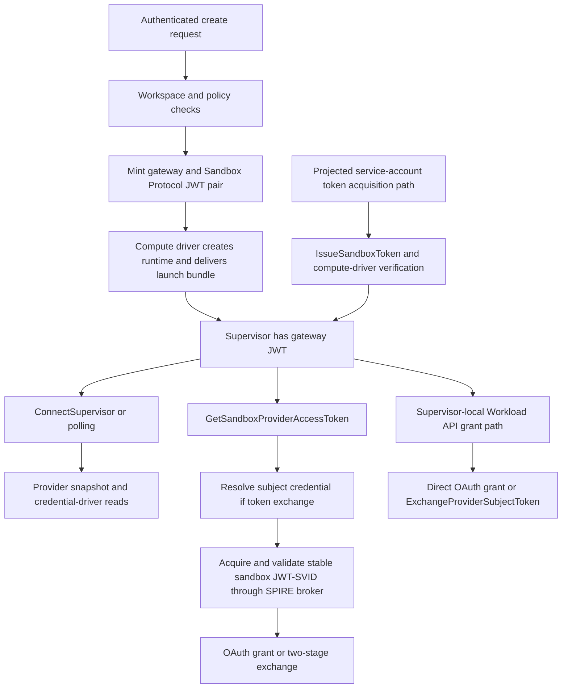

## Evidence boundary

Verified means inspected source at commit `ed8a0d98acee9b7f9e4efe004bc6a748524406b7` on 2026-11-19, not a successful deployment test. Each factual entry links to a file and starting line; the surrounding function supplies the rest of the evidence. Unverified means a proposal, inference requiring deployment validation, or an unresolved question. This pass changes documentation only. The proposed behavior is in [the design](01-design.md).

## Actual sequence and branches

Verified: the requested linear sequence is not one universal execution path. Creation mints launch credentials; some supervisors receive them directly. The service-account exchange is an alternative acquisition path and precedes the authenticated control-stream RPC. Provider configuration delivery, gateway-brokered grants, and supervisor-local grants are separate credential paths. Sources are expanded below.

Verified: the diagram represents source alternatives, not a guarantee that `IssueSandboxToken` follows direct launch delivery. The acquisition helper prioritizes environment JWT, then JWT file, then projected service-account exchange at [crates/openshell-core/src/grpc_client.rs:620](../../crates/openshell-core/src/grpc_client.rs#L620). Kubernetes can deliver the serialized supervisor auth bundle in a Secret at [crates/openshell-driver-kubernetes/src/driver.rs:3975](../../crates/openshell-driver-kubernetes/src/driver.rs#L3975), or in a shared-instance registration at [crates/openshell-driver-kubernetes/src/driver.rs:5893](../../crates/openshell-driver-kubernetes/src/driver.rs#L5893).

| Step | Identity available and what the gateway verifies | Source evidence and status |
| --- | --- | --- |
| Sandbox create request | User principal; no sandbox runtime identity, session JWT, or sandbox SVID yet. `handle_create_sandbox_inner` extracts the principal, requires workspace user access, resolves an active workspace, validates the sandbox spec, canonicalizes policy, and checks credential-policy compatibility. | Verified. [grpc/sandbox.rs:556](../../crates/openshell-server/src/grpc/sandbox.rs#L556), [grpc/sandbox.rs:681](../../crates/openshell-server/src/grpc/sandbox.rs#L681), [grpc/sandbox.rs:697](../../crates/openshell-server/src/grpc/sandbox.rs#L697). |
| Resolve launch inputs | Sandbox UUID, workspace, providers, effective policy, configured driver. The create-time helper resolves effective policy without exporting credential state. This is not workload attestation. | Verified. `resolve_sandbox_create_runtime_inputs`, [grpc/policy.rs:3789](../../crates/openshell-server/src/grpc/policy.rs#L3789). |
| Mint launch JWTs | Gateway generates a runtime generation, credential epoch, and current gateway token ID. `mint_persisted_launch` mints two typed JWTs. Neither a compute runtime response nor SVID is required by the mint function. | Verified. [grpc/sandbox.rs:792](../../crates/openshell-server/src/grpc/sandbox.rs#L792), [auth/sandbox_jwt.rs:171](../../crates/openshell-server/src/auth/sandbox_jwt.rs#L171), [auth/sandbox_jwt.rs:237](../../crates/openshell-server/src/auth/sandbox_jwt.rs#L237). |
| Compute driver create/start | Gateway passes launch material to the selected driver. The driver creates the runtime and returns its runtime identity; the gateway requires a nonempty identity when authentication is supported, then persists the driver/runtime binding. This occurs after the initial JWT mint. | Verified. `create_sandbox_with_runtime_inputs_and_guards`, [compute/mod.rs:1790](../../crates/openshell-server/src/compute/mod.rs#L1790), [compute/mod.rs:1860](../../crates/openshell-server/src/compute/mod.rs#L1860). Kubernetes RPC delegates to `driver.create_sandbox` at [driver-kubernetes/src/grpc.rs:149](../../crates/openshell-driver-kubernetes/src/grpc.rs#L149). |
| Supervisor acquires gateway bearer | Direct launch material already contains the JWT. The alternative `acquire_k8s_sandbox_token` reads a projected SA token and calls `IssueSandboxToken` before installing the gateway bearer. No SVID is used in that exchange. | Verified. [core/src/grpc_client.rs:620](../../crates/openshell-core/src/grpc_client.rs#L620), [core/src/grpc_client.rs:661](../../crates/openshell-core/src/grpc_client.rs#L661). |
| Optional `IssueSandboxToken` | Compute-driver principal only. The authenticator delegates native bearer validation solely on this RPC. The handler compares driver name and immutable runtime identity against stored annotations, reads persisted generation/epoch/token ID, and mints the gateway token. It does not acquire or validate a sandbox SVID. | Verified. [auth/compute_driver.rs:28](../../crates/openshell-server/src/auth/compute_driver.rs#L28), `handle_issue_sandbox_token`, [grpc/auth_rpc.rs:63](../../crates/openshell-server/src/grpc/auth_rpc.rs#L63), [grpc/auth_rpc.rs:134](../../crates/openshell-server/src/grpc/auth_rpc.rs#L134). |
| Authenticate ordinary supervisor RPCs | Gateway session JWT. The verifier checks typed signed claims, exact issuer/audience/subject, lifetime, generation format, and JTI. The authenticator also checks persisted phase, generation, epoch, and current token ID, except refresh has its own lineage check. | Verified. [core/src/jwt.rs:1076](../../crates/openshell-core/src/jwt.rs#L1076), [core/src/jwt.rs:1137](../../crates/openshell-core/src/jwt.rs#L1137), [auth/sandbox_jwt.rs:358](../../crates/openshell-server/src/auth/sandbox_jwt.rs#L358), [auth/sandbox_session.rs:281](../../crates/openshell-server/src/auth/sandbox_session.rs#L281), [auth/sandbox_session.rs:320](../../crates/openshell-server/src/auth/sandbox_session.rs#L320). |
| `ConnectSupervisor` | Gateway JWT principal; hello must name the same sandbox. Client queues hello, opens the stream, and awaits acceptance. In push mode the server builds a provider-bearing configuration bootstrap; this is not an SVID gate. | Verified. [supervisor-process/src/supervisor_session.rs:696](../../crates/openshell-supervisor-process/src/supervisor_session.rs#L696), [server/src/supervisor_session.rs:2544](../../crates/openshell-server/src/supervisor_session.rs#L2544), [server/src/supervisor_session.rs:2648](../../crates/openshell-server/src/supervisor_session.rs#L2648). |
| Provider snapshot, push or poll | Session principal and sandbox authorization, without requiring a sandbox SVID in these functions. Snapshot building calls the credential runtime; plain stored credentials and handle-resolved values are considered for delivery subject to profile, expiry, and endpoint-binding checks. | Verified. Polling handler at [grpc/policy.rs:3843](../../crates/openshell-server/src/grpc/policy.rs#L3843); shared materialization at [grpc/policy.rs:3944](../../crates/openshell-server/src/grpc/policy.rs#L3944); push bootstrap at [config_delivery/session.rs:927](../../crates/openshell-server/src/config_delivery/session.rs#L927); values and driver resolution at [grpc/provider.rs:1318](../../crates/openshell-server/src/grpc/provider.rs#L1318), [grpc/provider.rs:1364](../../crates/openshell-server/src/grpc/provider.rs#L1364), [grpc/provider.rs:1393](../../crates/openshell-server/src/grpc/provider.rs#L1393). |
| Gateway-brokered provider-token request | `GetSandboxProviderAccessToken` requires sandbox principal and the original gateway bearer, revalidates persisted session, resolves an attached configured credential/profile, and rejects non-Kubernetes drivers. Audiences/scopes come from gateway configuration. For token exchange it resolves the subject credential before SVID acquisition and before token-cache lookup. | Verified. `obtain`, [grpc/provider/access_token.rs:206](../../crates/openshell-server/src/grpc/provider/access_token.rs#L206), [grpc/provider/access_token.rs:99](../../crates/openshell-server/src/grpc/provider/access_token.rs#L99), [grpc/provider/access_token.rs:240](../../crates/openshell-server/src/grpc/provider/access_token.rs#L240), [grpc/provider/access_token.rs:264](../../crates/openshell-server/src/grpc/provider/access_token.rs#L264). |
| Gateway-owned SPIRE adapter | Persisted runtime identity and authenticated session. `acquire` obtains runtime identity from the sandbox record and calls `SandboxIdentityProvider::fetch_jwt_svid`. `SpireSandboxIdentity` computes the exact expected sandbox SPIFFE ID. | Verified. [grpc/provider/access_token.rs:392](../../crates/openshell-server/src/grpc/provider/access_token.rs#L392), [spire/src/lib.rs:42](../../crates/openshell-spire/src/lib.rs#L42), [spiffe/src/lib.rs:132](../../crates/openshell-spiffe/src/lib.rs#L132). |
| SPIRE broker and SVID verification | Adapter derives a Kubernetes Sandbox CR UID reference from persisted runtime identity. It fetches gateway X.509 identity and bundles from the Workload API, establishes SPIFFE-authenticated broker TLS, requests one exact sandbox JWT-SVID, fetches JWT bundles, validates signature/audience/lifetime through `JwtSvid::parse_and_validate`, and checks exact subject equality. Calls have a timeout. | Verified. `reference`, [spire/src/broker.rs:156](../../crates/openshell-spire/src/broker.rs#L156); `channel`, [spire/src/broker.rs:188](../../crates/openshell-spire/src/broker.rs#L188); `fetch`, [spire/src/broker.rs:269](../../crates/openshell-spire/src/broker.rs#L269). |
| OAuth grant or exchange | Gateway session plus verified stable sandbox SVID. Client-credentials grant uses the sandbox SVID as client assertion. Subject-token exchange first uses a gateway component SVID and stored subject credential for an intermediate token addressed to the sandbox SPIFFE ID, then the sandbox SVID and intermediate token for the final configured audience/scopes. | Verified. [grpc/provider/access_token.rs:418](../../crates/openshell-server/src/grpc/provider/access_token.rs#L418), [grpc/provider/access_token.rs:445](../../crates/openshell-server/src/grpc/provider/access_token.rs#L445). Gateway component SVID helper at [grpc/provider.rs:4782](../../crates/openshell-server/src/grpc/provider.rs#L4782). |
| Final token response/cache | Gateway rechecks provider/profile/attachment and session before returning or caching. Cache hits do not reacquire an SVID; serving lifetime is capped by the acquisition's session, SVID, subject, and issuer bounds. This is not current device-posture revalidation. | Verified. [grpc/provider/access_token.rs:294](../../crates/openshell-server/src/grpc/provider/access_token.rs#L294), [grpc/provider/access_token.rs:338](../../crates/openshell-server/src/grpc/provider/access_token.rs#L338), [grpc/provider/access_token.rs:477](../../crates/openshell-server/src/grpc/provider/access_token.rs#L477). |
| Vault/provider credentials | Vault is a storage branch, not a mandatory step after OAuth. `CredentialRuntime::resolve_provider_handles` calls the issuer, which batches driver requests. Vault validates managed secret paths, obtains its own Vault client token, and reads KV values. These credentials can be read for provider snapshots or as exchange prerequisites. | Verified. [credentials.rs:202](../../crates/openshell-server/src/credentials.rs#L202), [credential-issuer/src/embedded.rs:551](../../crates/openshell-credential-issuer/src/embedded.rs#L551), [driver-vault/src/lib.rs:248](../../crates/openshell-driver-vault/src/lib.rs#L248), [driver-vault/src/lib.rs:389](../../crates/openshell-driver-vault/src/lib.rs#L389). |

## Other paths that affect enforcement

Verified: supervisors can fetch JWT-SVIDs directly from their Workload API and perform a client-credentials grant directly. For subject-token exchange they call `ExchangeProviderSubjectToken` for the intermediate token, then perform the final exchange locally. `run` selects this resolver separately from `GatewayTokenGrantResolver`. Sources: [supervisor-network/src/run.rs:312](../../crates/openshell-supervisor-network/src/run.rs#L312), [supervisor-network/src/token_grant.rs:204](../../crates/openshell-supervisor-network/src/token_grant.rs#L204), [supervisor-network/src/token_grant.rs:309](../../crates/openshell-supervisor-network/src/token_grant.rs#L309).

Verified: `exchange_provider_subject_token_inner` requires the session's sandbox ID to match the request and checks provider attachment. It resolves stored subject material at line 4522, then validates the presented supervisor SVID at line 4531. `validate_supervisor_jwt_svid` checks issuer, audience, same trust domain as the gateway, and cryptographic validity, but does not compare the SVID subject to a sandbox-derived exact SPIFFE ID. These functions contain no device or Gate 1 binding. Sources: [grpc/provider.rs:4405](../../crates/openshell-server/src/grpc/provider.rs#L4405), [grpc/provider.rs:4515](../../crates/openshell-server/src/grpc/provider.rs#L4515), [grpc/provider.rs:4835](../../crates/openshell-server/src/grpc/provider.rs#L4835). Unverified: exploitability under a particular SPIRE deployment or authorization-server policy.

Verified: refresh rotates persisted gateway token lineage with a bounded request-matched retry, can issue extension credentials, and returns both session token profiles. Ordinary RPCs reject consumed predecessors. A protobuf comment still says older tokens remain valid to expiry; handler and persistence code supersede that comment for this source trace. Sources: [grpc/auth_rpc.rs:291](../../crates/openshell-server/src/grpc/auth_rpc.rs#L291), [grpc/auth_rpc.rs:329](../../crates/openshell-server/src/grpc/auth_rpc.rs#L329), [auth/sandbox_session.rs:338](../../crates/openshell-server/src/auth/sandbox_session.rs#L338), [auth/sandbox_session.rs:369](../../crates/openshell-server/src/auth/sandbox_session.rs#L369), [proto/openshell.proto:787](../../proto/openshell.proto#L787).

Verified: restart/recovery and shared-supervisor takeover also mint launch material. Shared supervision has a separate process token and per-sandbox assignments. A per-sandbox gate must survive owner changes rather than trusting the shared process token alone. Sources: [compute/mod.rs:1174](../../crates/openshell-server/src/compute/mod.rs#L1174), [compute/mod.rs:2513](../../crates/openshell-server/src/compute/mod.rs#L2513), [supervisor_pool.rs:2916](../../crates/openshell-server/src/supervisor_pool.rs#L2916), [core/src/jwt.rs:193](../../crates/openshell-core/src/jwt.rs#L193).

Verified: credential storage also serves non-sandbox operations. `GetProviderCredentials` requires an operator principal, and the issuer resolve contract carries provider/workspace ownership rather than a sandbox decision. A blanket ban on all Vault access until some sandbox passes Gate 2 would change management behavior too. Sources: [grpc/provider_credentials.rs:39](../../crates/openshell-server/src/grpc/provider_credentials.rs#L39), [credential-issuer/src/embedded.rs:578](../../crates/openshell-credential-issuer/src/embedded.rs#L578).

## Credential inventory and first-credential terminology

Unverified definition proposed for approval: distinguish the first bootstrap credential from the first protected provider credential. Gate 1 must precede every first per-generation session JWT pair; Gate 2 must precede resolving, minting, returning, or using any provider credential on behalf of that sandbox. A cached or preexisting secret counts on first use, even if OpenShell did not issue it. Acquiring an SVID retained inside the gateway is a permitted identity-verification prerequisite, not permission to access a provider.

Unverified consequence of that definition: the two-gate design cannot promise all three verified signals before literally any credential exists. The initial JWT and the evidence SVID are deliberate prerequisites. If “first credential” includes either artifact with no exception, the requested two-gate architecture is insufficient and launch must be redesigned.

| Artifact | When issued or acquired and who holds it | Status and source |
| --- | --- | --- |
| Requester OIDC/mTLS identity or local-development principal | Exists before create. The gateway consumes an established identity; it does not establish device posture through this identity model. | Verified. Identity fields/provider kinds at [auth/identity.rs:13](../../crates/openshell-server/src/auth/identity.rs#L13). |
| Gateway-facing session JWT | Minted at create and later issuance/renewal/recovery. `typ` is `openshell-gateway-session+jwt`; audience is the gateway issuer; supervisor holds bearer. `sub` looks like a SPIFFE ID but is gateway-authored, not a SPIRE SVID. | Verified. [core/src/jwt.rs:48](../../crates/openshell-core/src/jwt.rs#L48), [core/src/jwt.rs:170](../../crates/openshell-core/src/jwt.rs#L170), [core/src/jwt.rs:997](../../crates/openshell-core/src/jwt.rs#L997). |
| `sandbox_token` local variable in create | Alias of the gateway-facing token, forwarded through driver input; not a third independent credential. | Verified. [grpc/sandbox.rs:802](../../crates/openshell-server/src/grpc/sandbox.rs#L802), [compute/mod.rs:1790](../../crates/openshell-server/src/compute/mod.rs#L1790). |
| Sandbox Protocol session JWT | Second token minted in the launch pair, audience `openshell-sandbox`, type `openshell-sandbox-session+jwt`. Held by supervisor for runtime attachment; refreshed alongside gateway token. Distinct from the preceding variable despite the shared name. | Verified. [core/src/jwt.rs:48](../../crates/openshell-core/src/jwt.rs#L48), [auth/sandbox_jwt.rs:256](../../crates/openshell-server/src/auth/sandbox_jwt.rs#L256), [grpc/auth_rpc.rs:395](../../crates/openshell-server/src/grpc/auth_rpc.rs#L395). |
| Projected Kubernetes service-account token | Kubernetes-provided bootstrap input; consumed only when this acquisition path is selected. TokenReview binds it to namespace, expected SA, live pod UID, and Sandbox owner. | Verified. [core/src/grpc_client.rs:661](../../crates/openshell-core/src/grpc_client.rs#L661), [driver-kubernetes/src/driver.rs:1335](../../crates/openshell-driver-kubernetes/src/driver.rs#L1335). |
| Shared-supervisor process JWT and takeover grant | Separate supervisor token authenticates the assignment stream; takeover grant plus new per-instance pair is minted for an owner change. Neither is a provider token or SVID. | Verified. [core/src/jwt.rs:50](../../crates/openshell-core/src/jwt.rs#L50), [core/src/jwt.rs:193](../../crates/openshell-core/src/jwt.rs#L193), [auth/sandbox_jwt.rs:297](../../crates/openshell-server/src/auth/sandbox_jwt.rs#L297), [supervisor_pool.rs:2944](../../crates/openshell-server/src/supervisor_pool.rs#L2944). |
| Gateway X.509-SVID/private key and trust bundles | Fetched from gateway Workload API for broker TLS. SVID/key are infrastructure credentials; bundles are verification material. | Verified. [spire/src/broker.rs:198](../../crates/openshell-spire/src/broker.rs#L198). |
| Stable sandbox JWT-SVID | Fetched after launch, on brokered token acquisition. Kept in gateway in this path. Stable subject contains configured prefix, gateway ID and sandbox ID; it is not the session JWT subject. | Verified. [spire/src/lib.rs:42](../../crates/openshell-spire/src/lib.rs#L42), [spiffe/src/lib.rs:132](../../crates/openshell-spiffe/src/lib.rs#L132), [grpc/provider/access_token.rs:409](../../crates/openshell-server/src/grpc/provider/access_token.rs#L409). |
| Supervisor JWT-SVID and gateway component JWT-SVID | Supervisor-local path obtains its own assertion. Gateway component assertion is fetched when minting intermediate exchange tokens. These do not replace gateway session authentication. | Verified. [supervisor-network/src/token_grant.rs:224](../../crates/openshell-supervisor-network/src/token_grant.rs#L224), [grpc/provider/access_token.rs:422](../../crates/openshell-server/src/grpc/provider/access_token.rs#L422), [grpc/provider.rs:4413](../../crates/openshell-server/src/grpc/provider.rs#L4413). |
| Intermediate OAuth access token | Authorization server issues it in subject-token exchange, addressed to sandbox/supervisor SPIFFE identity. Held in gateway in brokered path, returned to supervisor in the other path. | Verified. [grpc/provider/access_token.rs:431](../../crates/openshell-server/src/grpc/provider/access_token.rs#L431), [grpc/provider.rs:4561](../../crates/openshell-server/src/grpc/provider.rs#L4561). |
| Final OAuth access token | Authorization server issues after client assertion grant or exchange. Gateway returns it via provider-access-token RPC; local resolver can obtain it directly. | Verified. [grpc/provider/access_token.rs:445](../../crates/openshell-server/src/grpc/provider/access_token.rs#L445), [grpc/provider/access_token.rs:367](../../crates/openshell-server/src/grpc/provider/access_token.rs#L367), [supervisor-network/src/token_grant.rs:226](../../crates/openshell-supervisor-network/src/token_grant.rs#L226). |
| Static API keys, subject tokens, provider files and refresh material | Stored provisioned secrets, not necessarily minted during bootstrap. Snapshot delivery or exchange can resolve/use them without creating a new secret. Handles are storage references, not proof of sandbox authorization. | Verified. [grpc/provider.rs:1202](../../crates/openshell-server/src/grpc/provider.rs#L1202), [grpc/provider.rs:4611](../../crates/openshell-server/src/grpc/provider.rs#L4611), [credentials.rs:237](../../crates/openshell-server/src/credentials.rs#L237). |
| Vault client token and its auth lease duration | Driver reads token file or logs into Kubernetes auth; client token stays in driver and may be cached for 80% of login lease duration. Login is conditional on a storage operation, not a sandbox SVID exchange. | Verified. [driver-vault/src/lib.rs:314](../../crates/openshell-driver-vault/src/lib.rs#L314), [driver-vault/src/lib.rs:348](../../crates/openshell-driver-vault/src/lib.rs#L348). |
| Vault KV value versus dynamic secret lease | Current driver returns KV value with `expiration_time: None`; it does not return a per-sandbox dynamic-secret lease in this path. The login token's `lease_duration` is not such a lease. | Verified. [driver-vault/src/lib.rs:265](../../crates/openshell-driver-vault/src/lib.rs#L265), [driver-vault/src/lib.rs:283](../../crates/openshell-driver-vault/src/lib.rs#L283), [driver-vault/src/lib.rs:118](../../crates/openshell-driver-vault/src/lib.rs#L118). Unverified: external deployment use of dynamic Vault leases or SPIFFE auth. |
| Extension service JWTs | Issued on refresh when selected extension services qualify. A bootstrap restriction must cover these as well as provider credentials. | Verified. [grpc/auth_rpc.rs:332](../../crates/openshell-server/src/grpc/auth_rpc.rs#L332), [grpc/auth_rpc.rs:424](../../crates/openshell-server/src/grpc/auth_rpc.rs#L424). |
| SSH host private key and OTLP headers/client TLS | Launch encoding can prepare SSH identity and apply telemetry credentials. These are sensitive launch/infrastructure material, not evidence of device posture. | Verified. [compute/mod.rs:1139](../../crates/openshell-server/src/compute/mod.rs#L1139), [compute/mod.rs:1157](../../crates/openshell-server/src/compute/mod.rs#L1157). |
| Proxy CA private key, upstream client TLS and image-pull secrets | Kubernetes launch can create a supervisor Secret containing proxy CA key/client TLS and create image-pull Secrets. These are additional pre-SVID credentials in runtime provisioning. | Verified. [driver-kubernetes/src/driver.rs:3975](../../crates/openshell-driver-kubernetes/src/driver.rs#L3975), [driver-kubernetes/src/driver.rs:3996](../../crates/openshell-driver-kubernetes/src/driver.rs#L3996). |

## What the existing identities do and do not establish

Verified: Kubernetes native authentication validates a projected token through TokenReview, expected account/namespace, pod UID, and Sandbox ownership, and returns `kubernetes://<namespace>/<resource-uid>/<pod-uid>`. It does not inspect host hardware, measured boot, or posture in this function. The gateway's `trust_domain: Some("openshell")` on the resulting principal is a constant, not a SPIRE attestation. Sources: [driver-kubernetes/src/driver.rs:1335](../../crates/openshell-driver-kubernetes/src/driver.rs#L1335), [driver-kubernetes/src/driver.rs:6462](../../crates/openshell-driver-kubernetes/src/driver.rs#L6462), [auth/compute_driver.rs:61](../../crates/openshell-server/src/auth/compute_driver.rs#L61).

Verified: the broker request references a Sandbox CR UID, not a device attestation. `SandboxJwtSvid` returns only SPIFFE ID, token, and expiration; the gateway adapter does not receive SPIRE selectors, node identity, or posture as separate verified attributes. Sources: [spire/src/broker.rs:156](../../crates/openshell-spire/src/broker.rs#L156), [spiffe/src/lib.rs:147](../../crates/openshell-spiffe/src/lib.rs#L147). Unverified: deployed SPIRE attestor/registration configuration and whether it proves a suitable hardware/device binding.

Verified: session claims have no decision ID, device ID, scope/stage, SVID-binding field, or confirmation key, and reject unknown fields. Session TTL is an issuer-level setting; omitted gateway TTL selects non-expiring session credentials, while the SPIRE broker configuration requires a positive TTL. Sources: [core/src/jwt.rs:178](../../crates/openshell-core/src/jwt.rs#L178), [core/src/jwt.rs:997](../../crates/openshell-core/src/jwt.rs#L997), [core/src/config.rs:1150](../../crates/openshell-core/src/config.rs#L1150), [server/src/spiffe_broker.rs:41](../../crates/openshell-server/src/spiffe_broker.rs#L41).

Verified: `SandboxSpec` contains policy and providers, with no first-class mission, owner binding, or requested authorization-profile field. Create accepts request annotations, so annotations alone are not a verified authorization source. Sources: [proto/openshell.proto:1108](../../proto/openshell.proto#L1108), [grpc/sandbox.rs:707](../../crates/openshell-server/src/grpc/sandbox.rs#L707). Unverified: the external authority that should supply those bindings.
