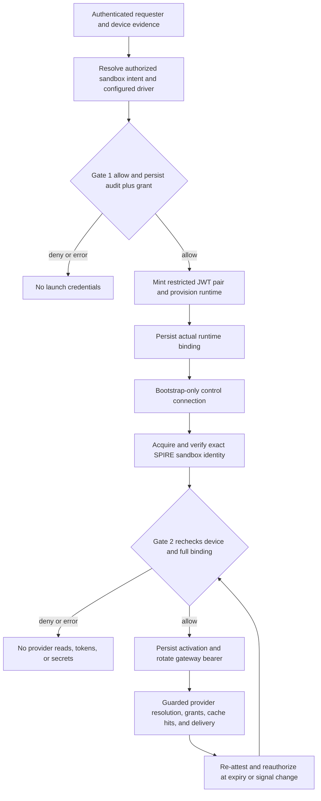

## Status and recommendation

Unverified proposal, pending user approval: use two gates with one pluggable decision engine and multiple enforcement points. Gate 1 authorizes creation and a restricted bootstrap JWT pair. Gate 2 combines fresh device evidence, the Gate 1 sandbox grant, current runtime identity, and a verified SPIRE identity before provider-secret resolution, token acquisition, or credential delivery. Retain gateway-issued session JWTs. Use the existing Vault credential driver initially. Default the feature off; when enabled, missing configuration or evidence must deny rather than fall back to current behavior.

Evidence convention: every paragraph, table, diagram, and list in a subsection marked “Unverified proposal” describes intended behavior, not an existing API or a validated implementation. Verified findings include `file:line` links to the inspected commit `ed8a0d98acee9b7f9e4efe004bc6a748524406b7`. Deployment capabilities and feasibility that the source cannot establish remain unverified. [The current-flow document](00-current-flow.md) records the underlying trace and artifact inventory.

Verified motivation: initial credentials precede the driver create response and SVID acquisition; provider snapshots can resolve secrets without the token broker; brokered token exchange resolves a stored subject before obtaining the SVID. Sources: [grpc/sandbox.rs:792](../../crates/openshell-server/src/grpc/sandbox.rs#L792), [compute/mod.rs:1860](../../crates/openshell-server/src/compute/mod.rs#L1860), [grpc/policy.rs:3944](../../crates/openshell-server/src/grpc/policy.rs#L3944), [grpc/provider/access_token.rs:264](../../crates/openshell-server/src/grpc/provider/access_token.rs#L264).

### Credential boundary

Unverified proposal: approve the following invariant explicitly. Before Gate 1, issue no per-sandbox launch credentials. Between gates, permit only restricted runtime/gateway bootstrap credentials and tightly scoped infrastructure prerequisites. Before successful Gate 2, perform no provider-secret resolution, provider OAuth grant/exchange, provider-secret delivery, or provider credential use for that sandbox, including cache hits. Gate 2 obtains the evidence SVID inside the gateway before deciding; do not release it as a general credential to the supervisor.

Unverified proposal: “first protected credential” means the first such provider operation on behalf of a sandbox runtime generation, whether it concerns a new OAuth token, preexisting API key, Vault KV value, provider file, or future dynamic lease. This is a conditional admission design. It does not claim that all three signals exist before the first bootstrap JWT or before SPIRE issues the evidence SVID. Requiring that literal ordering would require a different provisioning architecture.

Unverified proposal: classify gateway-to-SPIRE credentials, image-pull authentication, local proxy CA, and strictly internal runtime-attachment keys as infrastructure prerequisites with explicit destinations and privileges. Defer provider-facing upstream client TLS and extension bearer issuance until Gate 2. Decide whether SSH and OTLP credentials qualify as narrowly scoped infrastructure or must be deferred. Generic credentials to arbitrary services cannot be exempted by naming them “bootstrap.” Provider storage/refresh by an independently authorized administrator or background controller remains a separate control-plane operation; attaching a sandbox must not invoke that authority as a bypass.

## Gate placement and available signals

Unverified proposal: the following state machine describes the intended design.

| Signal | Gate 1 | Gate 2 | Status |
| --- | --- | --- | --- |
| Requester identity and workspace permission | Authenticate requester, require create permission, resolve stable subject and workspace. | Recheck the persisted owner/mission authorization and its version; a supervisor bearer is not a user identity. | Unverified proposal. Existing workspace admission is verified at [grpc/sandbox.rs:560](../../crates/openshell-server/src/grpc/sandbox.rs#L560). |
| Owner/mission and policy profile | Resolve from a trusted authorization source; bind canonical policy digest/revision, workload template provenance, provider set, and sandbox UUID. Never trust a mission label alone. | Require the same current binding; changed policy/owner/provider attachment invalidates the grant. | Unverified proposal. Existing spec/provenance handling is verified at [grpc/sandbox.rs:579](../../crates/openshell-server/src/grpc/sandbox.rs#L579), [grpc/sandbox.rs:681](../../crates/openshell-server/src/grpc/sandbox.rs#L681). |
| Device identity and posture | Verify requester device by default for the first slice; retain subject type explicitly. Host evidence is required here only if an attested host has actually been reserved. | Revalidate freshness, revocation, and binding of that same device. If host posture is policy-required, also require actual placement-to-host evidence. | Unverified proposal. No suitable attestation evidence is established by the inspected compute authentication function at [driver-kubernetes/src/driver.rs:1335](../../crates/openshell-driver-kubernetes/src/driver.rs#L1335). |
| Configured compute driver | Check the gateway-controlled driver selection and trust/configuration revision. Do not describe this as proof of a particular runtime or physical device. | Check persisted driver name and actual immutable runtime identity, current generation, epoch, and ownership term. | Unverified proposal. Configured name and later runtime persistence are verified at [compute/mod.rs:1376](../../crates/openshell-server/src/compute/mod.rs#L1376), [compute/mod.rs:1860](../../crates/openshell-server/src/compute/mod.rs#L1860). |
| Runtime/pod native identity | Not yet available at the current pre-mint point. Leave it explicitly pending. | Verify against the recorded driver response; native `IssueSandboxToken` authentication can contribute this evidence. | Verified availability constraint. [grpc/sandbox.rs:797](../../crates/openshell-server/src/grpc/sandbox.rs#L797), [grpc/auth_rpc.rs:134](../../crates/openshell-server/src/grpc/auth_rpc.rs#L134). Proposed use is unverified. |
| SPIFFE ID and signed SVID | Expected stable SPIFFE ID can be computed; no actual sandbox SVID is available or proven. | Acquire and cryptographically verify SVID, exact expected ID, trust domain, audience, lifetime, runtime reference and current bundle. Do not accept same-domain membership alone. | Unverified proposal using verified mapping/validation at [spiffe/src/lib.rs:132](../../crates/openshell-spiffe/src/lib.rs#L132), [spire/src/broker.rs:269](../../crates/openshell-spire/src/broker.rs#L269). |
| SPIRE selectors and node attestation | No attested workload selectors are available. | Require a trusted assertion about selector/registration and runtime/device mapping if policy needs those attributes. A JWT-SVID alone must not be treated as exposing them. | Verified interface limitation at [spiffe/src/lib.rs:147](../../crates/openshell-spiffe/src/lib.rs#L147). Attribute acquisition and deployment policy remain unverified. |

### Gate 1 admission

Unverified proposal: insert Gate 1 after canonical policy/attachment and driver validation, before `PersistedSandboxIdentity::new` and `mint_persisted_launch`. Include generated sandbox UUID and planned generation in a gateway-owned grant; persist an auditable decision before any launch token is returned or dispatched. The authorization record must be stored outside caller-writable annotations. Deny if device evidence, trusted owner/mission binding, policy resolution, configured-driver trust, policy evaluation, or durable commit fails.

Verified attachment point: the current canonical inputs and mutation guard exist before the mint at [grpc/sandbox.rs:771](../../crates/openshell-server/src/grpc/sandbox.rs#L771). Actual runtime identity is not returned until [compute/mod.rs:1860](../../crates/openshell-server/src/compute/mod.rs#L1860).

Unverified proposal: “compute-driver identity” at Gate 1 means the trusted driver service/configuration, not an attested sandbox. The initial grant records runtime identity as pending. A trusted control-plane transaction binds the resulting runtime identity to that grant after provisioning. Gate 2 denies until that step succeeds. Host-required policy must deny at Gate 1 if host reservation/evidence is unavailable; it cannot substitute requester posture for host posture. Supporting such policies would require a pre-launch placement/attestation step that is not demonstrated by the current create flow.

### Gate 2 activation and resource authorization

Unverified proposal: invoke one shared authorization service after runtime identity is durable and the exact SVID has been verified, before every sandbox-authorized path reaches a provider driver, token endpoint, credential cache, or credential-bearing delivery. It checks active Gate 1 grant, device evidence, sandbox/gateway IDs, generation, credential epoch, current JTI lineage, policy/owner/provider revisions, exact SPIFFE mapping, permitted audience and resource. Production activation also requires the proof of possession described below. First success persists an activation decision and rotates to a bound, short-lived gateway JWT; subsequent access must validate that activation, its expiry, current evidence versions and the caller's key or authenticated channel.

Unverified proposal: use the existing `SandboxIdentityProvider` boundary to acquire evidence in the gateway, including for static-Vault-only sandboxes. An authorization-only SVID audience for that use is a new configuration/design requirement, not an existing OpenShell endpoint or guaranteed SPIRE feature configuration. The SVID remains inside the gateway; policy evaluation receives verified attributes and an evidence digest, never an unverified JWT payload or secret.

Verified sequencing constraint: `IssueSandboxToken` is currently a native-identity-to-JWT exchange with no SVID input; direct launch credentials bypass it. Therefore it cannot be the universal Gate 2 point. Sources: [grpc/auth_rpc.rs:63](../../crates/openshell-server/src/grpc/auth_rpc.rs#L63), [proto/openshell.proto:776](../../proto/openshell.proto#L776), [core/src/grpc_client.rs:620](../../crates/openshell-core/src/grpc_client.rs#L620).

Unverified proposal: keep `IssueSandboxToken` able to return only the Gate 1 bootstrap-limited token after checking the saved grant and native runtime binding. It may trigger Gate 2 when sufficient evidence exists, but that is an optimization. Directly provisioned supervisors and static-provider paths must pass the same Gate 2 service independently. No new public RPC is assumed in this design; whether activation occurs during `ConnectSupervisor`, first guarded provider request, or a future dedicated exchange requires implementation review.

## The pre-SVID trust gap

Verified: current session JWTs have no scopes or bootstrap/full stage. Sandbox access is selected by method annotations and same-sandbox handler checks. The allowlist includes `ConnectSupervisor`, `GetSandboxConfig`, and provider exchange; provider environment and provider access-token RPCs explicitly accept sandbox principals. Sources: [core/src/jwt.rs:178](../../crates/openshell-core/src/jwt.rs#L178), [auth/sandbox_methods.rs:4](../../crates/openshell-server/src/auth/sandbox_methods.rs#L4), [auth/sandbox_methods.rs:23](../../crates/openshell-server/src/auth/sandbox_methods.rs#L23), [proto/openshell.proto:541](../../proto/openshell.proto#L541).

Unverified proposal: add explicit token purpose/stage and enforced capabilities, not merely a decorative `scope` claim. Bootstrap tokens may establish the same-sandbox control connection, obtain credential-free configuration, report bounded setup status, attach to their own runtime using the second token profile, and attempt evidence-bound activation/limited renewal. They must not authorize provider snapshots containing values/files, OAuth grants, cached tokens, extension JWTs, provider-facing TLS keys, or unrestricted relays. Start the workload without managed provider secrets or hold it until activation, according to an explicit policy choice.

Unverified proposal: `ConnectSupervisor` may be allowed at the method boundary while its provider-bearing bootstrap remains blocked. Separate credential-free configuration from secret materialization and never treat an empty provider snapshot as authorization success. A bootstrap-only refresh may extend within an absolute Gate 1 bootstrap deadline only; it cannot renew indefinitely or promote privilege. Promotion/renewal requires a new current decision, and a consumed bootstrap bearer must not remain a usable provider capability.

Verified risk: current push bootstrap immediately calls provider-environment materialization, and later reconciliation can reuse a cached provider snapshot. A method-only scope check would miss those secret deliveries. Sources: [server/src/supervisor_session.rs:2648](../../crates/openshell-server/src/supervisor_session.rs#L2648), [config_delivery/session.rs:927](../../crates/openshell-server/src/config_delivery/session.rs#L927), [config_delivery/mod.rs:465](../../crates/openshell-server/src/config_delivery/mod.rs#L465).

## Evidence and policy interfaces

### Device attestation

Unverified proposal: define a device-attestation adapter that verifies an opaque evidence reference against a gateway challenge and expected subject. Its verified result must identify issuer/provider, device ID, subject kind (`requester` or `host`), bound requester or runtime/host identity, challenge digest, issue/expiry times, posture attributes, verification-key/evidence version, and revocation epoch. Validation must include issuer trust, signature, challenge, audience, freshness, and binding, with a deadline and bounded payload size. This is a proposed internal interface, not a current OpenShell API.

Unverified proposal: first implementation supplies a mock adapter only in tests. Production enablement without a configured real verifier denies. A possible real provider is a TPM-backed attestation verifier or an authenticated device-management posture service; choice, evidence format, enrolled keys, and delivery channel are unverified. Network address, pod labels, service-account membership, and the configured compute-driver name must not be elevated into hardware attestation.

### Workload and sandbox evidence

Verified: `SandboxIdentityProvider::fetch_jwt_svid` accepts gateway ID, sandbox ID, audience, and trusted persisted runtime identity. It does not supply device identity or selectors. SPIRE adapter currently translates only Kubernetes runtime references, and provider-token acquisition explicitly rejects non-Kubernetes drivers. Sources: [spiffe/src/lib.rs:168](../../crates/openshell-spiffe/src/lib.rs#L168), [spire/src/broker.rs:158](../../crates/openshell-spire/src/broker.rs#L158), [grpc/provider/access_token.rs:240](../../crates/openshell-server/src/grpc/provider/access_token.rs#L240).

Unverified proposal: retain that portable workload-identity abstraction, but document Kubernetes as the initially supported adapter. Other drivers deny when the feature requires an unavailable SPIRE binding. SPIRE registration/selector and node-attestation policy must be verified independently, with a trusted evidence extension if the PDP evaluates selectors or device linkage. A future adapter must not synthesize verified selector values from caller labels.

Unverified proposal: resolve sandbox authorization from an authenticated owner/mission authority plus current workspace membership, canonical requested policy and provider permissions. Store the source and version of each binding. The source, schema, and profile catalog for mission authorization are open questions; no owner/mission or authorization-profile field is assumed to exist in `SandboxSpec`.

### One decision contract and a pluggable PDP

Unverified proposal: introduce an internal `BootstrapAuthorizer` abstraction, with a local OPA/Rego implementation as default and a replaceable backend for future VAAS integration. Evidence verification stays in trusted adapters; PDP output cannot turn unverified evidence into verified facts. A fixed local policy query and validated policy revision are configuration, not caller-selected parameters. OPA process versus embedded Rego execution, transport, packaging, and deployment are unverified choices; no implementation exists in this pass.

Unverified proposal: the following is a logical schema shared by both stages, not a protobuf definition or an existing endpoint. Nullable pending inputs are permitted only in the stage where the table above explicitly says they do not exist. Gate 2 requires all three verified signal families.

| Decision request group | Required contents | Status |
| --- | --- | --- |
| Envelope | Schema version, stage, gateway-generated request/challenge ID, time/deadline, operation, policy bundle revision. | Unverified proposal. |
| Sandbox authorization | Gateway/sandbox/workspace IDs, canonical policy profile/digest/revision, owner or mission authority/binding/version, provider attachment epoch and requested resource/audience/scopes. | Unverified proposal. |
| Device | Adapter-verified attributes, subject kind and identity, issue/expiry time, posture/evidence version, revocation epoch, challenge binding. Raw evidence stays out of PDP logs. | Unverified proposal. |
| Driver/runtime | Configured driver identity/config revision; runtime identity, generation, epoch and JTI when available; placement/host binding if required. | Unverified proposal. |
| Workload | Expected SPIFFE ID at Gate 1; verified exact ID, trust domain, audience, SVID expiry, evidence digest and trustworthy registration/selector facts at Gate 2. | Unverified proposal. |
| Parent authorization | Gate 1 decision ID, immutable input digest, grant expiry, device identity, current signal versions, activation/renewal counter. Gate 1 has no parent. | Unverified proposal. |

| Decision response field | Meaning | Status |
| --- | --- | --- |
| Outcome and reason | Exactly allow or deny plus bounded machine-readable reason. Errors, missing/malformed decisions, timeout and unknown outcomes become deny at enforcement. | Unverified proposal. |
| Decision identity | Gateway-controlled decision ID correlated with request, stage, input digest, and evaluated policy revision. A remote response cannot redirect authorization to another request. | Unverified proposal. |
| Validity | Issue/expiry time and positive TTL cap. Effective TTL is no longer than every required signal and parent grant. | Unverified proposal. |
| Capabilities | Allowed internal capabilities, provider/resource/audience bounds, and OAuth scopes intersected with existing policy/profile permissions. Gate 1 can issue bootstrap capabilities only. Deny yields none. | Unverified proposal. |

Unverified proposal: defaults deny; example Rego rules should require device compliance, trusted owner/mission authorization, configured driver trust and current policy at Gate 1, then fresh full binding and exact SPIFFE identity at Gate 2. Enforcement must independently clamp scopes/TTL and validate correlation even when Rego returns allow. No policy or adapter errors can return a legacy credential.

## Binding a JWT to a later SVID

Verified: current `SessionClaims` is signed, has `deny_unknown_fields`, and contains sandbox ID, generation, epoch and JTI but no decision/device/SVID or `cnf` field. The gateway authenticator projects that verified token into a sandbox principal and does not retain a workload confirmation key. Sources: [core/src/jwt.rs:178](../../crates/openshell-core/src/jwt.rs#L178), [core/src/jwt.rs:997](../../crates/openshell-core/src/jwt.rs#L997), [auth/sandbox_jwt.rs:374](../../crates/openshell-server/src/auth/sandbox_jwt.rs#L374).

Unverified proposal: Gate 1 JWTs carry a bootstrap authorization claim with decision ID, device ID and subject kind, expected SPIFFE ID marked unverified, grant/policy revision, stage and capability/TTL bounds. Gate 2 persists a link to the actual verified SPIFFE ID and current runtime identity, then issues a successor gateway JWT carrying Gate 1 and Gate 2 decision IDs, verified SPIFFE ID and device binding. A signed JWT cannot be updated in place; reissuance and atomic lineage rotation implement promotion. Keep the Sandbox Protocol token type/audience distinct and define its restricted capability separately.

Unverified proposal: compare identities via the gateway's stored mapping; do not compare the session JWT's SPIFFE-shaped `sub` directly to the stable SPIRE subject. Server-side correlation plus a rotated bearer is an authorization binding, not proof of possession. Adding a digest of a bearer JWT-SVID still does not prove a private key is held by the caller. A slice that implements correlation alone remains experimental and must not be described as satisfying the production bootstrap-token theft requirement.

Verified: the evidence SVID type here is a JWT bearer assertion, while the broker transport uses a separate gateway X.509 key. The stable sandbox SPIFFE mapping is `<prefix>/gateway/<gateway-id>/sandbox/<sandbox-id>` and the current session subject is `spiffe://openshell/sandbox/<sandbox-id>`. Sources: [spiffe/src/lib.rs:147](../../crates/openshell-spiffe/src/lib.rs#L147), [spire/src/broker.rs:223](../../crates/openshell-spire/src/broker.rs#L223), [spiffe/src/lib.rs:132](../../crates/openshell-spiffe/src/lib.rs#L132), [core/src/jwt.rs:997](../../crates/openshell-core/src/jwt.rs#L997).

### Production proof-of-possession requirement

Verified: the gateway broker request derives the runtime reference from the sandbox record named by the authenticated session, then fetches that sandbox's SVID. No caller-held key is supplied to this acquisition. Sources: [grpc/provider/access_token.rs:392](../../crates/openshell-server/src/grpc/provider/access_token.rs#L392), [spiffe/src/lib.rs:173](../../crates/openshell-spiffe/src/lib.rs#L173). Unverified threat analysis: a stolen bootstrap bearer could therefore trigger acquisition of the correct sandbox SVID; matching that SVID to the session would not, by itself, distinguish the legitimate supervisor from the thief. Deployment-specific exploitability has not been tested.

Unverified proposal: require either an authenticated workload channel or a fresh gateway challenge signed by a key held by the authorized workload/supervisor instance before Gate 2 promotion. Independently attest or enroll that key against the expected runtime identity and, where required, its host/device identity. Possession of the bootstrap bearer alone must not authorize enrolling a replacement key. In shared supervision, bind the proof to the exact sandbox assignment, runtime generation and ownership term.

Unverified proposal: bind each promotion challenge to the gateway, sandbox, runtime generation, credential epoch, bootstrap JTI, Gate 1 decision, intended operation/audience and expiry. Consume it atomically once; reject missing proof, wrong key, altered context, expired challenges and cross-sandbox replay. If an authenticated channel supplies the proof, verify its identity against the same context rather than treating ordinary server-authenticated TLS as caller authentication. No suitable enrollment or channel-binding protocol has been verified in this pass.

Unverified proposal: retain the key/channel binding after promotion. Verify it on protected requests, renewal, cached credential responses and credential-bearing stream delivery; require fresh proof on reconnect or key/ownership change. A proposed `cnf` claim can identify the confirmation key, but adding the claim without enforcing possession is insufficient. Gate 2 errors must deny before protected driver reads, token issuance or secret delivery. Compromise of the bound workload key or its authorized supervisor remains a residual risk.

Unverified proposal: mixed-version gateways/runtimes must be version-gated because existing claims reject unknown fields; enabling the feature requires a compatible fleet and stored decision state. Disabled mode preserves current token serialization and behavior.

## Can the broker be the only Gate 2 enforcement point?

Verified answer: no, for the current code. A common gateway policy service can make the decision, but the existing SPIRE adapter is not a complete enforcement boundary.

| Path | Why a broker-only check misses it | Required change, unverified proposal |
| --- | --- | --- |
| Brokered access-token exchange | Subject credential resolves before `acquire` fetches SVID. Cache hits bypass SVID acquisition. Verified at [access_token.rs:264](../../crates/openshell-server/src/grpc/provider/access_token.rs#L264), [access_token.rs:294](../../crates/openshell-server/src/grpc/provider/access_token.rs#L294). | Acquire evidence and authorize before any subject-driver read or cache return; recheck decision state before response. |
| Provider config push and poll | Shared snapshot materializer reads driver handles without calling the SPIRE adapter. Verified at [policy.rs:3944](../../crates/openshell-server/src/grpc/policy.rs#L3944). Reconciliation reuses snapshots at [config_delivery/mod.rs:465](../../crates/openshell-server/src/config_delivery/mod.rs#L465). | Guard materialization and delivery, including existing snapshot caches, with the same current activation decision. |
| Supervisor-local OAuth grants | Direct Workload API client-credentials grant does not call gateway broker. Verified at [token_grant.rs:224](../../crates/openshell-supervisor-network/src/token_grant.rs#L224). | In enabled mode, require gateway provider identity source and deny unsupported local grant paths; ensure SPIRE mounts/registration and authorization-server policy do not enable direct unguarded grants. |
| Intermediate exchange RPC | Has its own same-domain SVID validation and resolves subject material first. Verified at [provider.rs:4522](../../crates/openshell-server/src/grpc/provider.rs#L4522), [provider.rs:4835](../../crates/openshell-server/src/grpc/provider.rs#L4835). | Require full exact workload/decision binding before driver access or cached intermediate-token return, or disable this legacy path in enabled mode. |
| Native bootstrap and direct launch | `IssueSandboxToken` is optional and lacks SVID evidence. Verified at [auth_rpc.rs:83](../../crates/openshell-server/src/grpc/auth_rpc.rs#L83), [grpc_client.rs:620](../../crates/openshell-core/src/grpc_client.rs#L620). | Neither path may produce a full provider-capable session until Gate 2. |

Unverified proposal: use a typed internal authorization permit for sandbox-scoped provider resolution, with decision ID and resource bounds, and require it at callers that fetch or deliver secrets. The generic credential issuer serves independent administrative operations and currently has no sandbox context; do not silently change its provider-owner contract into an attestation API. The Vault driver can remain KV storage behind those guarded callers. SPIFFE login to Vault and dynamic Vault leases are future integration choices, not current capabilities of this driver.

Verified Vault boundary: `VaultAuthSettings` supports Kubernetes login and token-file authentication; resolve returns a KV value without a dynamic-secret expiry. Sources: [driver-vault/src/lib.rs:68](../../crates/openshell-driver-vault/src/lib.rs#L68), [driver-vault/src/lib.rs:283](../../crates/openshell-driver-vault/src/lib.rs#L283).

## Replay, expiry, revocation and audit

Unverified proposal: enforce the following at both gates and on renewal.

| Failure or change | Enforcement rule | Residual risk or open dependency |
| --- | --- | --- |
| Missing, unverifiable or stale evidence; unavailable PDP/adapter; timeout | Deny, emit bounded reason, issue/use no protected credential. No stale-allow fallback. | Availability depends on evidence and policy services. |
| Challenge or decision replay | Gateway-generated one-use challenge, short expiry, immutable input digest, exact parent/stage/resource binding; consume activation in a shared transactional store. Do not accept client-supplied allow decisions. | Cross-replica atomicity and recovery must be tested. |
| Concurrent activation or renewal | CAS against generation, epoch, JTI and grant version; an identical retry may recover the committed result without minting a different successor. Recheck current revocation before serving recovery. | Requires integrating existing replay semantics with evidence expiry. |
| Clock skew | Validate signed issue/expiry bounds; proposed maximum 30 seconds future-issue skew, strict expiry at enforcement. Set TTL to the minimum of device/grant/SVID/policy/session bounds; deny if no usable positive lifetime remains. | Device clock source and production skew budget remain unverified. |
| Device/posture, owner/mission, policy, provider, runtime, selector, trust bundle or supervisor placement change | Increment trusted evidence/revocation versions, invalidate activation and all affected caches/snapshots, re-attest before further use. Recheck after asynchronous work and before external minting/delivery. | Event delivery alone is insufficient; current versions must be read at enforcement. |
| Renewal | Re-attest device, reacquire/revalidate workload evidence, recheck sandbox authorization and apply a new decision TTL cap. Bootstrap renewal cannot silently promote. | Proof refresh cost and startup timeout need sizing. |
| Already-delivered static key or OAuth token | Stop new access immediately, revoke upstream if supported; otherwise bound usable lifetime and rotate secrets. | Gateway cache invalidation cannot recall an exported credential. |
| Audit persistence failure | Deny before mint/delivery if decision plus enforcement record cannot be durably accepted. | Existing nonblocking logs alone do not prove durable delivery. |

Verified prior art: persisted session authorization already checks generation, epoch and JTI, and refresh has request-matched bounded retries plus CAS rotation. Session lifetime verification currently permits up to 30 seconds leeway and nonexpiring tokens; the positive issuer TTL range is one minute to one hour. New bootstrap TTL caps cannot be implemented by merely changing one global default. Sources: [auth/sandbox_session.rs:320](../../crates/openshell-server/src/auth/sandbox_session.rs#L320), [auth/sandbox_session.rs:338](../../crates/openshell-server/src/auth/sandbox_session.rs#L338), [auth/sandbox_session.rs:369](../../crates/openshell-server/src/auth/sandbox_session.rs#L369), [core/src/jwt.rs:65](../../crates/openshell-core/src/jwt.rs#L65), [core/src/jwt.rs:1288](../../crates/openshell-core/src/jwt.rs#L1288), [core/src/jwt.rs:1378](../../crates/openshell-core/src/jwt.rs#L1378).

Unverified proposal: write structured records at each enforcement attempt, including rejects before the PDP is called. Record decision/request/parent IDs, stage, outcome and bounded reason, sandbox/gateway/workspace/generation/epoch, device subject kind and ID, verified/expected SPIFFE identity with status, driver/runtime reference, policy/evidence revisions, resource/capability bounds, issue/expiry times and final enforcement result. Never log JWTs, SVIDs, Vault tokens, secret values, raw attestations or remote diagnostic bodies. Durable allow decision and state activation must precede credential side effects; a post-side-effect audit failure requires reconciliation, not reporting that no issuance occurred.

Verified logging convention: gateway auth audit already uses structured OCSF authentication/API/security events and avoids presented credentials/raw verification diagnostics. Extend that convention with a durable decision record rather than assuming an ordinary log statement is a transactional authorization store. Source: [auth/audit.rs:4](../../crates/openshell-server/src/auth/audit.rs#L4).

## Alternatives

| Alternative | Assessment | Status |
| --- | --- | --- |
| Two gates, restricted launch then full workload authorization | Fits the current pre-runtime mint order while protecting provider credentials. Requires capability-aware JWTs, durable state, multiple enforcement points and an explicit exception for identity/bootstrap credentials. Recommended subject to the open questions below. | Unverified proposal. |
| One gate only at current JWT mint | Cannot verify a runtime/SVID that does not exist yet. Would require pre-provisioned workload identity and attested placement before minting launch credentials. | Verified ordering limitation at [grpc/sandbox.rs:797](../../crates/openshell-server/src/grpc/sandbox.rs#L797), [compute/mod.rs:1860](../../crates/openshell-server/src/compute/mod.rs#L1860); architectural alternative unverified. |
| One gate only at provider access | Can protect provider access if every secret/grant path is covered, but does not authorize or limit initial session issuance. Restricting its initial token already adds a first-stage admission rule in substance. | Unverified assessment, based on verified provider paths listed above. |
| One gate only in SPIRE broker or Vault | Misses local OAuth, static snapshot delivery, cached responses or non-Vault credentials; storage does not have full sandbox context. | Verified coverage limitations at [token_grant.rs:224](../../crates/openshell-supervisor-network/src/token_grant.rs#L224), [policy.rs:3944](../../crates/openshell-server/src/grpc/policy.rs#L3944), [credential-issuer/src/embedded.rs:578](../../crates/openshell-credential-issuer/src/embedded.rs#L578). |
| Leave behavior unchanged | Retains existing session/runtime/provider controls; does not add combined device/workload/sandbox admission. | Verified boundaries in [current flow](00-current-flow.md); security sufficiency for any deployment is unverified. |

## Proposed implementation files

Unverified proposal: these are candidate extension points, not changes made or guaranteed sufficient without implementation review. All listed existing functions and starting lines were verified in source. New interfaces/modules below are explicitly proposed.

| Existing file and function | Proposed change |
| --- | --- |
| [grpc/sandbox.rs:556](../../crates/openshell-server/src/grpc/sandbox.rs#L556), `handle_create_sandbox_inner`, mint at [797](../../crates/openshell-server/src/grpc/sandbox.rs#L797) | Gate 1 before mint; canonical policy/owner/device binding; restricted launch artifact handling. |
| [compute/mod.rs:1653](../../crates/openshell-server/src/compute/mod.rs#L1653), `create_sandbox_with_runtime_inputs_and_guards`; [1174](../../crates/openshell-server/src/compute/mod.rs#L1174), `encode_persisted_launch_authentication`; restart mint at [2518](../../crates/openshell-server/src/compute/mod.rs#L2518) | Commit runtime binding to pending grant; enforce admission on new generation/recovery; separate infrastructure keys from deferred provider TLS. |
| [grpc/sandbox.rs:2039](../../crates/openshell-server/src/grpc/sandbox.rs#L2039), `mint_persisted_authentication`; [supervisor_pool.rs:2918](../../crates/openshell-server/src/supervisor_pool.rs#L2918), `mint_takeover` | Carry current decisions through launch recovery; invalidate workload/host grants on changed placement/term. |
| [auth/sandbox_jwt.rs:171](../../crates/openshell-server/src/auth/sandbox_jwt.rs#L171), `mint_persisted_launch`; [358](../../crates/openshell-server/src/auth/sandbox_jwt.rs#L358), `SandboxSessionJwtAuthenticator::authenticate`; [core/src/jwt.rs:178](../../crates/openshell-core/src/jwt.rs#L178), `SessionClaims` | Add explicit authorization binding and capabilities, per-decision TTL, verification/projection and compatible disabled serialization. Review all callers and both token profiles. |
| [auth/sandbox_session.rs:99](../../crates/openshell-server/src/auth/sandbox_session.rs#L99), `PersistedSandboxIdentity`; [320](../../crates/openshell-server/src/auth/sandbox_session.rs#L320), `authorize_persisted` | Integrate durable decision references, current evidence versions, atomic promotion/revocation with existing lineage. |
| [grpc/auth_rpc.rs:63](../../crates/openshell-server/src/grpc/auth_rpc.rs#L63), `handle_issue_sandbox_token`; [246](../../crates/openshell-server/src/grpc/auth_rpc.rs#L246), `handle_refresh_sandbox_token` | Validate Gate 1, bootstrap-only issue, re-attestation on full renewal, no extension credentials before activation. |
| [auth/sandbox_methods.rs:15](../../crates/openshell-server/src/auth/sandbox_methods.rs#L15), `is_sandbox_callable`; [proto/openshell.proto:541](../../proto/openshell.proto#L541), provider RPC authorization annotations | Add capability-aware enforcement without weakening existing method and sandbox checks. Public schema changes need separate review; no new RPC assumed. |
| [supervisor_session.rs:2544](../../crates/openshell-server/src/supervisor_session.rs#L2544), `handle_connect_supervisor`; [config_delivery/session.rs:900](../../crates/openshell-server/src/config_delivery/session.rs#L900), `build_config_bootstrap`; [config_delivery/mod.rs:465](../../crates/openshell-server/src/config_delivery/mod.rs#L465), `provider_environment` | Permit credential-free bootstrap; authorize every secret materialization, cached snapshot reuse and stream delivery. |
| [grpc/policy.rs:3946](../../crates/openshell-server/src/grpc/policy.rs#L3946), `build_provider_environment_snapshot_from_inputs`; [grpc/provider.rs:1202](../../crates/openshell-server/src/grpc/provider.rs#L1202), `resolve_provider_environment_from_records_with_policy_bindings_and_credentials` | Require a current sandbox authorization permit before resolving static values/files or driver handles. |
| [grpc/provider/access_token.rs:206](../../crates/openshell-server/src/grpc/provider/access_token.rs#L206), `obtain`; [381](../../crates/openshell-server/src/grpc/provider/access_token.rs#L381), `acquire`; [159](../../crates/openshell-server/src/grpc/provider/access_token.rs#L159), `cache_key` | Gate 2 before subject read/cache access; bind caches to decision/evidence; recheck before external requests and response. |
| [grpc/provider.rs:4405](../../crates/openshell-server/src/grpc/provider.rs#L4405), `exchange_provider_subject_token_inner`; [4835](../../crates/openshell-server/src/grpc/provider.rs#L4835), `validate_supervisor_jwt_svid` | Exact sandbox SPIFFE and decision binding before any subject read/intermediate-token release, or explicit rejection in enabled mode. |
| [spiffe/src/lib.rs:168](../../crates/openshell-spiffe/src/lib.rs#L168), `SandboxIdentityProvider`; [spire/src/lib.rs:42](../../crates/openshell-spire/src/lib.rs#L42), `fetch_jwt_svid`; [spire/src/broker.rs:269](../../crates/openshell-spire/src/broker.rs#L269), `fetch` | Reuse verified SVID acquisition; evaluate evidence metadata/selector extension and an authorization-only audience without weakening exact-ID or bundle validation. |
| [supervisor-network/src/run.rs:312](../../crates/openshell-supervisor-network/src/run.rs#L312), resolver selection; [token_grant.rs:204](../../crates/openshell-supervisor-network/src/token_grant.rs#L204), local grant path | Enforce gateway-owned grants in enabled mode, no silent local fallback; align deployment SPIRE exposure and upstream trust policy. |
| [credentials.rs:202](../../crates/openshell-server/src/credentials.rs#L202), `resolve_provider_handles`; [credential-issuer/src/embedded.rs:551](../../crates/openshell-credential-issuer/src/embedded.rs#L551), `resolve`; [driver-vault/src/lib.rs:248](../../crates/openshell-driver-vault/src/lib.rs#L248), `resolve_credentials` | Review all sandbox resolution callers and verify zero protected driver calls on denial. Keep provider-owner storage and independent management operations explicit. No Vault SPIFFE-auth implementation assumed. |
| [core/src/config.rs:346](../../crates/openshell-core/src/config.rs#L346), `Config`; [server/src/lib.rs:663](../../crates/openshell-server/src/lib.rs#L663), startup wiring; [auth/audit.rs:4](../../crates/openshell-server/src/auth/audit.rs#L4) | Wire proposed authorizer/device adapters, default-off configuration, startup validation, durable decisions and structured audit. |

Unverified proposal: add internal modules for `BootstrapAuthorizer`, device attestation, decision schemas/state and local Rego policies/tests; their exact filenames are undecided. Update gateway configuration docs and deployment/debug guidance if implementation changes config, packaging or Helm. This design pass adds no flag, production module, policy, public API, or deployment change.

## Validation plan after approval

Unverified proposal: first implement deterministic unit tests for allow, explicit deny, each missing signal, expired/future attestation, wrong issuer/domain/audience, exact SPIFFE/sandbox/device mismatch, timeout, invalid PDP response, stale policy and replay. Test that only bootstrap capabilities can be issued before Gate 2, renewal cannot promote them, and disabled mode retains current serialized JWTs and behavior.

Unverified proposal: add a stolen-bootstrap-token test in which the gateway can obtain a valid SVID for the correct sandbox but the caller lacks the independently bound key; promotion and provider access must still deny. Cover bearer-only key enrollment, wrong-key signatures, tampered challenge context, concurrent challenge reuse, cross-sandbox/generation/ownership replay, expired proof, stolen promoted tokens, renewal, cache hits and stream reconnects. Every failed proof must produce zero protected credential-driver reads, OAuth requests and secret deliveries.

Unverified proposal: integration fixtures must exercise the actual gateway-owned route with mock gateway Workload API, SPIRE Broker API/JWT bundles, and a counting mock Vault credential driver. A Workload API-only mock does not represent the existing broker path. Assert zero provider-secret resolutions/OAuth requests on denial, including cached responses and subject-token exchange. Cover push, polling, cached snapshots, direct launch, native exchange, restart and shared-supervisor takeover, concurrent promotion and cross-replica revocation. Run relevant Rust/Helm/CI checks only when implementation exists; no such test result is claimed here.

## Threat model and residual risks

Unverified proposal: this table is the threat model for the proposed change, not proof that the mitigations are implemented.

| Threat | Proposed mitigation | Residual risk |
| --- | --- | --- |
| Stolen bootstrap JWT reaches provider secrets | Bootstrap capabilities, short deadline, independently bound workload-key/channel proof before Gate 2 promotion, and atomic challenge consumption. | Theft can disrupt bootstrap; correlation-only implementations retain a provider-access risk. Compromise of the bound key or attestation authority defeats this protection. |
| Stolen promoted JWT or reused proof reaches credentials | Enforce key/channel binding on protected requests, renewal, cache hits and credential-bearing streams; reject replay and reauthenticate reconnects. | Compromised authorized supervisor/key and credentials already exported require separate containment and revocation. |
| Valid same-domain SVID belongs to another sandbox | Exact mapped SPIFFE ID plus gateway/sandbox/runtime/generation/decision binding. | Compromised SPIRE authority or incorrect registration can assert an authorized identity. |
| Trusted service account mistaken for trusted device | Independent challenge-bound device verifier; distinguish requester and host. | Requester posture says nothing about a compromised runtime host. |
| Vault read or static config bypasses broker gate | Shared sandbox authorization permit before materialization, subject reads and cached delivery. | Missed callers, independent operator exports, or manually supplied secrets remain outside the intended boundary. |
| Direct supervisor OAuth bypasses gateway | Enforce gateway grant mode; limit Workload API access and authorization-server acceptance. | OpenShell code alone cannot revoke external grant paths or credentials already possessed. |
| Old decision or snapshot survives revocation | Shared versioned decisions, CAS lineage, cache invalidation plus current-version checks. | Previously exported static secrets and upstream tokens need upstream revocation/rotation. |
| Adapter/PDP unavailable or clocks diverge | Bounded calls, strict evidence expiry, deny on error. | Legitimate launch/renewal outages and sizing costs. |
| Shared supervisor reuses one sandbox's grant for another | Bind each assignment, runtime generation and epoch independently. | Compromised shared supervisor has access to every assigned sandbox's authorized material. |

## Open questions requiring approval or evidence

Unverified questions, not resolved assumptions:

1. Is the bootstrap-credential exception approved? If all three signals must precede the very first JWT or SVID, reject this two-gate design and authorize a provisioning redesign.
2. For the first slice, is requester-device posture sufficient, or must the actual compute host also be attested? Host-at-Gate-1 requires trusted placement/reservation before minting; the current create path supplies neither evidence nor a pre-mint runtime identity.
3. Which device verifier, enrollment authority, revocation source and challenge transport are available? No production evidence provider has been verified.
4. Which authority owns mission/owner permissions and authorization-profile names? How should its versions map to workspace permission, canonical policy and provider attachments? Request annotations must not serve as the authority.
5. Which deployed SPIRE registrations/selectors/node-attestors prove the Sandbox CR, supervisor and device/host relationships? Can trusted selector evidence be obtained, especially for shared supervision and non-Kubernetes drivers?
6. Should enabled mode reject supervisor-local grants and the legacy intermediate-exchange RPC initially? How will the authorization server and Workload API mounts enforce exclusive gateway mediation?
7. Which launch secrets are allowed before Gate 2? Upstream client TLS cannot be exempt if it authenticates to a protected provider. Decide SSH/OTLP scope and whether early image-pull credentials remain control-plane only.
8. What maximum bootstrap/activation TTLs, skew, durable-audit acceptance and outage budget are acceptable? Per-decision TTL and multi-replica state need implementation work beyond current issuer configuration.
9. Does the requirement prohibit provider-driver reads globally, or only sandbox-triggered resolution/use? Background refresh, provider management and internal SSH-key storage need explicit independent authorization if the stricter interpretation is intended.
10. How will already-exported static keys, provider files and OAuth tokens be revoked after posture change? The current KV driver supplies no per-sandbox dynamic lease or upstream revocation guarantee.
11. Which independently attested key enrollment and proof protocol will satisfy the production requirement: signed challenges, an authenticated workload channel, or another reviewed mechanism? Define its binding to shared-supervisor assignments, reconnects and key rotation before production enablement; the bootstrap bearer alone cannot establish that trust.

Unverified next step: after approval, implement the agreed slice in small commits with a default-off feature flag, the policy/adapter interfaces, guarded paths and tests. Until approval, the only deliverables are these documents.
